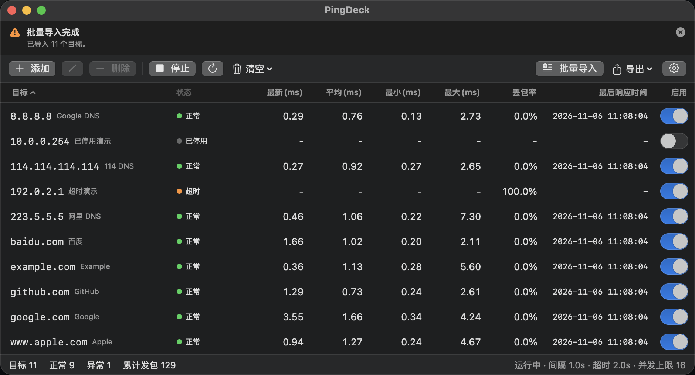

# PingDeck

**把一堆 IP 和域名丢进一张表，一眼看清谁在线、谁在丢包、谁在抖。**

PingDeck 是一个轻量的 macOS 批量 Ping 工具。它像 Windows 上的 PingInfoView 一样，把多个目标的连通状态、延迟和丢包率并排放在一张表格里，让你不用在终端里开一堆窗口。


## 截图



## 为什么用它

- **一屏看清全局**：所有目标同时监控，哪台机器挂了、哪条链路在丢包，扫一眼就知道
- **常驻几乎不耗电**：空闲时 CPU 0%，内存约 28MB，开着一天也不心疼
- **目标再多也不卡**：并发数可限制，超出上限时自动轮换，几百个目标也不会拖慢系统
- **零依赖**：直接用系统自带的 `ping`，不需要装任何东西，也不需要 root 权限
- **配置跟着你**：目标列表自动保存，下次打开就能接着用

## 安装

1. 到 [Releases](https://github.com/deathwhispers/pingdeck/releases) 下载最新的 `PingDeck-x.y.z.dmg`
2. 打开 DMG，把 PingDeck 拖进「应用程序」
3. 首次打开如果提示「无法验证开发者」，在 Finder 里右键点 PingDeck → 选择「打开」，之后就不会再提示

> 需要 macOS 13 或更高版本，支持 Apple 芯片与 Intel。

## 快速上手

1. 点「**添加**」加一个目标，或点「**批量导入**」一次粘贴一堆（每行一个，可写成 `8.8.8.8  Google DNS`）
2. 点「**开始**」
3. 表格里每一行会实时更新状态、延迟和丢包率

想只盯其中几个？关掉其他行的「启用」开关即可；想清掉历史数据，用「清空 → 清空结果」。

## 功能

| | |
| --- | --- |
| **批量监控** | 同时 Ping 任意数量的 IP / 域名，每个目标独立统计 |
| **实时指标** | 状态、最新延迟、平均延迟、最小 / 最大延迟、丢包率、最后响应时间 |
| **批量导入** | 粘贴多行文本即可建目标，支持「目标 备注」写法，自动跳过重复与非法行；可选择追加或整体替换 |
| **多选操作** | ⌘ 点击加选、⇧ 点击选区间、Delete 批量删除、一键清空全部 |
| **单行启停** | 关掉某行的「启用」开关会立即终止它的探测，不占资源 |
| **并发控制** | 设置最大并发数与轮换周期，目标再多也稳定 |
| **多格式导出** | 导出全部或仅选中项，支持 CSV / JSON / TXT / Markdown / Excel(XLSX)，Excel 打开不乱码 |
| **深色模式** | 跟随系统外观自动切换 |
| **自动保存** | 目标与设置写入本地配置，下次启动自动加载 |

## 界面说明

主界面是一张表格，从左到右依次是：

| 列 | 含义 |
| --- | --- |
| 目标 | 主机名或 IP，右侧灰字是备注 |
| 状态 | 正常 / 超时 / 不可达 / 已停用 / 错误 / 探测中 / 排队中 |
| 最新 (ms) | 最近一次回包的往返延迟 |
| 平均 (ms) | 本次运行以来所有回包的平均延迟 |
| 最小 / 最大 (ms) | 本次运行以来的极值 |
| 丢包率 | 已发但未回的包占比 |
| 最后响应时间 | 最近一次收到回包的本地时间 |
| 启用 | 该目标是否参与探测 |

点击任意表头可按该列排序，再点一次反向；没有数据的行始终排在最后。

**状态含义**

- **正常**：最近一次探测有回包
- **超时**：连续没有回包，可能网络不通或对方屏蔽了 ICMP
- **不可达**：本机到目标没有可用路由
- **已停用**：该行的「启用」开关被关闭，不会发起探测
- **错误**：目标无效（例如域名解析失败）或系统限制（例如权限不足）
- **探测中 / 排队中**：正在等待首个回包 / 受并发上限限制在排队

## 快捷键

| 操作 | 效果 |
| --- | --- |
| 点击行 | 选中该行 |
| ⌘ 点击 | 加选 / 取消选择 |
| ⇧ 点击 | 选中一段区间 |
| ⌘A | 在表格里全选目标；在输入框里全选文字 |
| Delete | 删除选中的目标 |

## 常见问题

**需要 root 权限吗？**
不需要。macOS 的 `ping` 使用非特权 ICMP socket，普通用户即可运行。

**为什么某些目标一直显示超时？**
常见原因：对方防火墙屏蔽了 ICMP、目标只开了 TCP 端口（ICMP 不响应不代表服务不可用）、或者本地路由不通。

**数据存放在哪里？**
`~/Library/Application Support/PingDeck/config.json`，删除该文件即可恢复初始状态。

**支持 IPv6 吗？**
支持。目标里包含 `:` 时会自动改用 `ping6`。

**为什么不能在 App Store 下载？**
App Sandbox 禁止创建子进程，也就无法调用系统 `ping`。PingDeck 因此采用直接分发（DMG）的方式。

## 更新日志

见 [CHANGELOG.md](CHANGELOG.md) 或 [Releases](https://github.com/deathwhispers/pingdeck/releases)。

## 从源码构建

需要 Xcode Command Line Tools。

```bash
git clone https://github.com/deathwhispers/pingdeck.git
cd pingdeck
make run     # 直接运行
make dmg     # 生成 dist/PingDeck-<版本号>.dmg
```

技术细节、目录结构、CI 流程和签名配置见 [docs/DEVELOPMENT.md](docs/DEVELOPMENT.md)。
