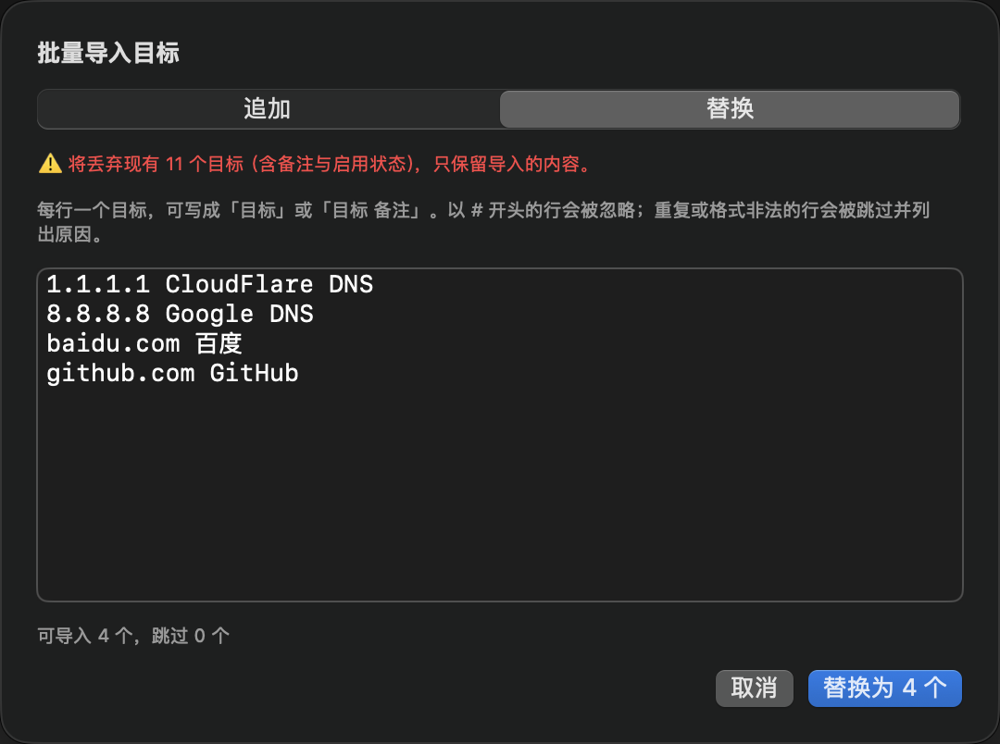
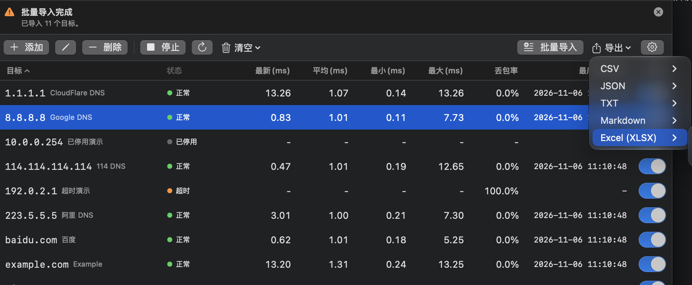
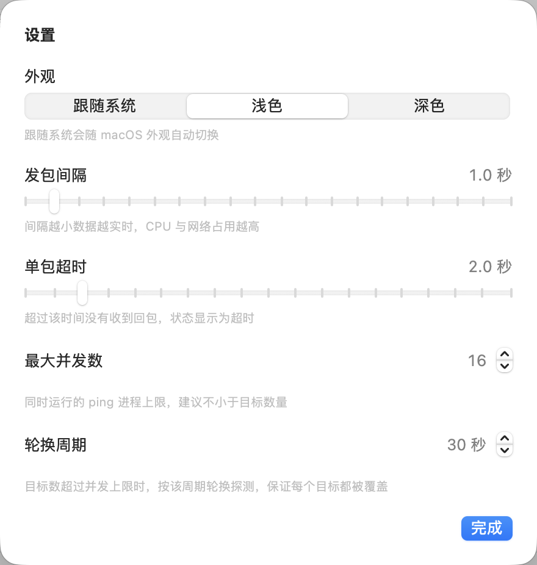
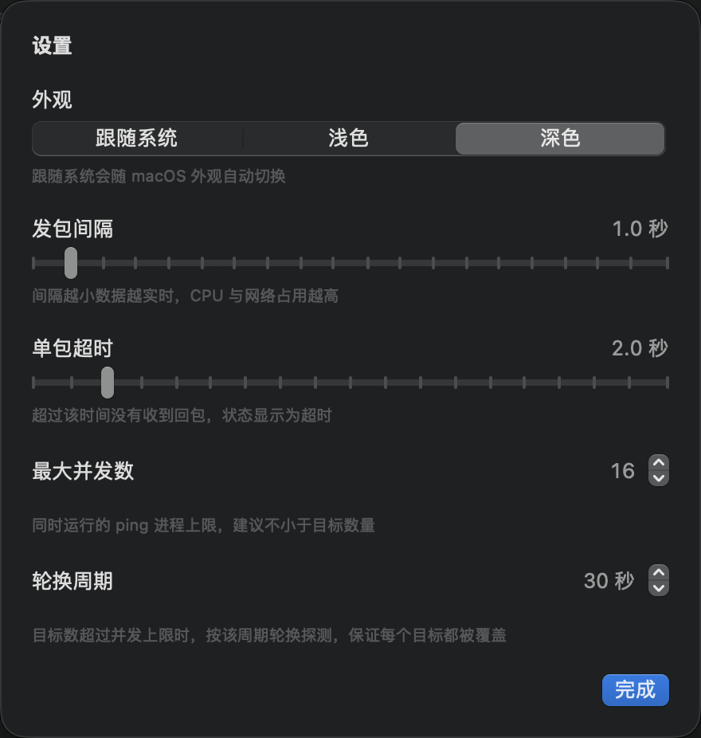

<p align="center">
  <picture>
    <source media="(prefers-color-scheme: dark)" srcset="docs/images/icon-dark.png">
    
  </picture>
</p>

<h1 align="center">PingDeck</h1>

<p align="center">
  <strong>macOS 上终于有一个顺手的批量 Ping 工具。</strong><br>
  把几十上百个 IP 和域名丢进一张表，实时看清谁在线、谁丢包、谁在抖。
</p>

<p align="center">
  <a href="https://github.com/deathwhispers/pingdeck/releases/latest"></a>
  
  
  
  
</p>

<p align="center">
  <a href="#安装"><strong>下载安装</strong></a> ·
  <a href="#快速上手">快速上手</a> ·
  <a href="#功能一览">功能一览</a> ·
  <a href="#常见问题">常见问题</a>
</p>

<p align="center">
  
  <br>
  <sub>11 个目标同时探测：状态、延迟、丢包率与最后响应时间，一屏尽收。</sub>
</p>

## 为什么用它

离线部署、机房上架、网络割接、值班巡检时，经常要同时确认几十上百台设备的连通性。在终端里逐个 `ping`，结果散落在滚动日志里，哪台掉线、哪条链路在丢包，很难一眼看清。

PingDeck 把这件事变成一张表：**粘贴目标，点开始，状态、延迟与丢包率实时刷新。**

- **机房上架**：设备通电后批量确认连通性，异常项一眼挑出
- **离线交付**：整段 IP 跑一遍，导出结果直接归档
- **网络割接**：割接前后对比延迟与丢包，快速判断是否需要回退
- **值班巡检**：常驻后台，长时间开着也不影响其他工作

## 界面预览

### 批量导入：粘贴即建目标

<p align="center">
  
  <br>
  <sub>粘贴多行目标，自动去重并预览可导入数量，支持追加或整体替换。</sub>
</p>

### 多格式导出：结果直接交付

<p align="center">
  
  <br>
  <sub>CSV / JSON / TXT / Markdown / Excel，可导出全部或仅选中项。</sub>
</p>

### 外观：跟随系统、浅色、深色

<table>
  <tr>
    <td width="50%" valign="top">
      
      <br>
      <sub><b>浅色</b>：明亮环境下更清晰。</sub>
    </td>
    <td width="50%" valign="top">
      
      <br>
      <sub><b>深色</b>：夜间与低光环境更舒适。</sub>
    </td>
  </tr>
</table>

设置面板同时提供发包间隔、单包超时、最大并发与轮换周期。

## 为什么这么轻

原生 Swift + SwiftUI 实现，不打包任何运行时。探测直接复用系统 `ping`：每个目标一个常驻子进程，发包节奏由内核控制；界面只做 4 Hz 的合并刷新。因此体积不到 2 MB，常驻内存约 28 MB，空闲 CPU 0%。

## 安装

1. 到 [Releases](https://github.com/deathwhispers/pingdeck/releases/latest) 下载最新的 `PingDeck-x.y.z.dmg`
2. 打开 DMG，把 PingDeck 拖进「应用程序」
3. 首次打开如果提示「无法验证开发者」，在 Finder 里右键点 PingDeck → 选择「打开」，之后就不会再提示

> 需要 macOS 14.4 或更高版本，支持 Apple 芯片与 Intel。

## 快速上手

1. 点「**添加**」直接输入单个目标或网段，或点「**批量导入**」一次粘贴多行（可写成 `8.8.8.8 Google DNS`）
2. 点「**开始**」
3. 表格会实时刷新状态、延迟和丢包率；点任意表头可排序

只想盯其中几台？关掉其他行的「启用」开关即可；想清掉历史数据，用「清空 → 清空结果」。

## 功能一览

| | |
| --- | --- |
| **批量监控** | 同时 Ping 任意数量的 IP / 域名，每个目标独立统计 |
| **实时指标** | 状态、最新延迟、平均延迟、最小 / 最大延迟、丢包率、最后响应时间 |
| **批量导入** | 粘贴多行文本或网段即可建目标，支持「目标 备注」写法，自动跳过重复与非法行；可选择追加或整体替换 |
| **单个添加** | 添加弹窗同样支持 IP、域名与网段，网段会展开为多个目标 |
| **多选操作** | ⌘ 点击加选、⇧ 点击选区间、Delete 批量删除、一键清空全部 |
| **列管理** | 拖动调整列宽、显示/隐藏列，内容超宽时横向滚动 |
| **单行启停** | 关掉某行的「启用」开关会立即终止它的探测，不占资源 |
| **并发控制** | 启动时自动匹配目标数量（最多 512），也可手动限制；超出上限按轮换周期覆盖 |
| **多格式导出** | 导出全部或仅选中项，支持 CSV / JSON / TXT / Markdown / Excel(XLSX) |
| **外观** | 跟随系统 / 浅色 / 深色，可在设置中随时切换 |
| **自动保存** | 目标与设置写入本地配置，下次启动自动加载 |

## 界面说明

主界面是一张表格，从左到右依次是：

| 列 | 含义 |
| --- | --- |
| 目标 | 主机名或 IP，右侧灰字是备注 |
| 状态 | 正常 / 超时 / 不可达 / 已停用 / 错误 / 探测中 / 排队中 |
| 最新 (ms) | 最近一次回包的往返延迟 |
| 平均 (ms) | 本次运行以来所有回包的平均延迟 |
| 最小 / 最大 (ms) | 本次运行以来的极值 |
| 丢包率 | 已发但未回的包占比 |
| 最后响应时间 | 最近一次收到回包的本地时间 |
| 启用 | 该目标是否参与探测 |

点击任意表头可按该列排序，再点一次反向；没有数据的行始终排在最后。列宽可以直接拖动表头分隔线调整；工具栏「列」菜单可以显示或隐藏列，设置会自动保存；列总宽超出窗口时可左右滚动。

**状态含义**

- **正常**：最近一次探测有回包
- **超时**：连续没有回包，可能网络不通或对方屏蔽了 ICMP
- **不可达**：本机到目标没有可用路由
- **已停用**：该行的「启用」开关被关闭，不会发起探测
- **错误**：目标无效（例如域名解析失败）或系统限制（例如权限不足）
- **探测中 / 排队中**：正在等待首个回包 / 受并发上限限制在排队

## 快捷键

| 操作 | 效果 |
| --- | --- |
| 点击行 | 选中该行 |
| ⌘ 点击 | 加选 / 取消选择 |
| ⇧ 点击 | 选中一段区间 |
| ⌘A | 在表格里全选目标；在输入框里全选文字 |
| Delete | 删除选中的目标 |

## 常见问题

**需要 root 权限吗？**
不需要。macOS 的 `ping` 使用非特权 ICMP socket，普通用户即可运行。

**能一次 ping 一整个网段吗？**
可以。批量导入支持 CIDR（如 `10.0.0.0/24`，需填写规范网络地址）、完整范围（`10.0.0.1-10.0.0.254`）与末段简写（`10.0.0.1-254`），粘贴后自动展开；单个网段最多 1024 个地址。

**目标很多时，能同时探测吗？**
可以。点「开始」时会自动把并发数提升到启用目标数量（最多 512），几百个目标可以同时探测；超过上限的部分按轮换周期覆盖，状态栏会显示排队数量。

**为什么某些目标一直显示超时？**
常见原因：对方防火墙屏蔽了 ICMP、目标只开了 TCP 端口（ICMP 不响应不代表服务不可用）、或者本地路由不通。

**数据存放在哪里？**
`~/Library/Application Support/PingDeck/config.json`，删除该文件即可恢复初始状态。

**支持 IPv6 吗？**
支持。目标里包含 `:` 时会自动改用 `ping6`。

**为什么采用 DMG 直接分发？**
App Sandbox 禁止创建子进程，也就无法调用系统 `ping`。PingDeck 因此采用直接分发（DMG）的方式。

## 从源码构建

需要 Xcode Command Line Tools。

```bash
git clone https://github.com/deathwhispers/pingdeck.git
cd pingdeck
make run     # 直接运行
make dmg     # 生成 dist/PingDeck-<版本号>.dmg
```

技术细节、目录结构、CI 流程和签名配置见 [docs/DEVELOPMENT.md](docs/DEVELOPMENT.md)。

## 参与贡献

欢迎提交 Issue 与 Pull Request。分支命名、提交信息与发布规则见 [CONTRIBUTING.md](CONTRIBUTING.md)。

## 更新日志

见 [CHANGELOG.md](CHANGELOG.md) 或 [Releases](https://github.com/deathwhispers/pingdeck/releases)。
